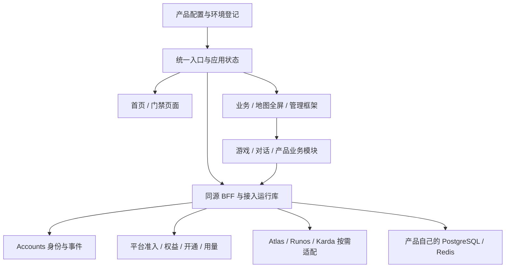
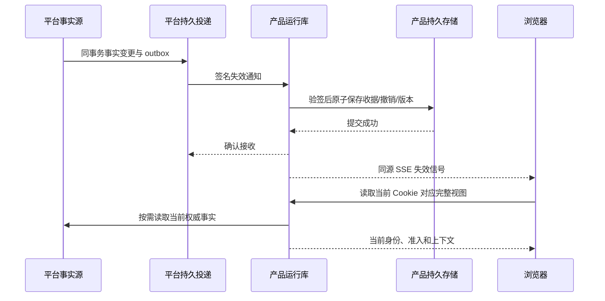

<!--
@package @vxtpl/app
@layer Application
@category Design
@author AI-Generated
@date 2026-11-25
-->

# vxtpl 产品模板底座设计

> 状态：分析与设计草案；本轮未修改应用代码、依赖、配置或线上环境。
> 日期：2026-11-25，Asia/Shanghai。
> 范围：标准平台接入、产品初始化、五类页面框架、独立 Header/Footer、Emberstorm 游戏模块、验证与升级机制。
> 设计修订：2026-11-25，按用户补充统一为首页、业务、地图全屏、门禁页面、管理五类；Header 是公共组合部件，不单独计一种框架。业务三栏的中栏必须保留，只有左右栏可按需显隐。
> HTML 设计交付：[完整交互设计](./20-framework-preview/index.html) · [使用说明与验证](./20-framework-preview/00-readme.md)。已完成静态设计稿与交互验证，应用代码接入仍待实施。
> 本文是实现设计，不另立跨仓接口标准。接口仍以[产品接入通则](https://claude.ai/code/artifact/20e37039-ea59-4c5d-9fab-ba3ca3ad54f0)及[产品接入范本](https://claude.ai/code/artifact/f0bd83c7-6296-4200-a7d8-108b7755f584)为权威；缺口须成对修订原件。

## 1. 目标与技术路线

把 vxtpl 建成可运行、可复制、可持续升级的产品底座。产品开发者提供产品标识，选择默认框架，添加业务模块，即可获得一致的登录、授权、退出、页面状态、部署与验收能力。

推荐保留 Next.js App Router + 同源 BFF + PostgreSQL + Redis 的默认应用形态。页面只通过同源接口使用平台能力；服务端持有令牌并执行权限判断。业务复杂后才增设 worker 或独立业务服务，五类页面框架共用一个应用与同一接入运行库。

核心构成：

1. **一份产品配置**：产品身份、品牌、导航、首页内容、模块启用与默认框架。
2. **一套版本化接入运行库**：身份、准入、事件恢复、商业 Webhook、用量及上游调用适配。产品业务不再自行实现这些机制。
3. **一套页面组合体系**：五类框架共用独立 Header、Footer、区域布局、工作区选择、账号菜单与恢复边界；差异通过有限的预设及插槽表达。
4. **一组独立功能模块**：Emberstorm、AI 对话等均通过模块清单接入，不能控制全站布局或自行创建登录体系。
5. **一条自动验收链**：配置预检、协议测试、浏览器矩阵及生成新产品的验证。修复进入版本化底座，后续产品通过依赖升级获得。



## 2. 已核查的现状与差距

### 2.1 核查基线

- 仓库：`D:\MyWebSite\vxtureagents\vx-agent-vxtpl`，远端 `vxture/vx-agent-vxtpl`。
- 远端 main：`3c6a38d3e96fa96f2c13b9d925554b3b7aa50dd6`。本地 main 仍为 `a00ea75`；已只读检查两者差异，未切换、重置或覆盖本地文件。
- 远端主线已包含 #95 单进程刷新合并及跨进程竞争后的重新读取，不能记成完全没有刷新保护。
- 现有未跟踪 `frame-left.svg`、`frame-right.svg` 保留；本方案不以它们为已批准视觉基线。
- 平台代码参考已发布身份批次所在检出 `vxture-platform-identity-release` 的 `6c45d9e`；外部产品事件能力尚未因此自动开放。
- 已读取通则及范本在线原件。两页仍有历史状态及描述差异，实施时须成对更新并标明实际交付版本。
- 在线只读查看 `https://vxtpl.vxture.com`：仍为 Emberstorm 全屏游戏入口；本轮没有发起真实账号登录、游戏或计费用量。

### 2.2 差距清单

| 领域 | 已有 | 本次必须补齐 |
| --- | --- | --- |
| 工程基础 | pnpm、Next.js、Prisma/PG、Redis、CI、镜像、部署/回滚、DDL 台账 | 版本锁定、自动预检、生成后验收、文档与实现一致 |
| 创建产品 | `scripts/init/rename-product.mjs` 重写名称级联 | 生成到新目录、排除运行态文件、平台登记驱动配置、可预览与可重复执行；不靠大范围文本替换维持长期升级 |
| 登录 | PKCE、一次性 state、nonce、服务端令牌 | 浏览器绑定与重复参数严格校验、身份/令牌故障分离、完整回调错误页、静默引导边界 |
| 刷新 | main 的进程内 single-flight 与失败后重新读取 | 跨实例锁/栅栏、原子版本写回、绝对到期、撤销后禁止写回；不能靠刷新延长原会话 |
| 退出 | RP 删除、中央 end_session、back-channel | 本地持久撤销、可靠确认、SSE、断线恢复、全链路结果核验 |
| 成员与准入 | 工作区订阅、功能档位门控 | 当前主体 `product-access`；按需 `product-roster`；平台席位与本地角色分开 |
| 权益 | C2 短缓存与 C3 驱逐 | 有界陈旧展示、不可读不冒充未购买、旧允许不能持续授权；跨实例失效 |
| 页面 | 游戏首页、简单导航、`/gate`、调试页 | 五类框架、独立 Header/Footer、统一分栏及全屏、完整状态与恢复 |
| 示例业务 | 游戏、记录、排行榜、配额、AI 对话 | 独立模块，沿用统一授权与请求层，可单独启用/卸载 |
| 文档 | 历史 ADR、实施说明、建仓清单 | 产品定位、框架规范、接入范本、发布流程和验收证据同步 |

静态代码核查发现的优先项，尚未在生产注入故障验证：

- `auth/logout/route.ts` 构造中央退出地址没有 `client_id`；现平台退出路由须据 client 解析 realm。实施前用协议回归重现，修正为当前契约。
- `auth/backchannel-logout/route.ts` 在撤销执行前领取重放标记，单会话删除错误被吞掉后仍回 200；失败重试可能被误记为已完成。
- `auth/lib/session-store.ts` 的 `putSession` 无撤销屏障；与在途刷新并发时存在重新写回风险。#95 解决了部分刷新竞争，未覆盖这个边界。
- `auth/session/route.ts`、`api/access/route.ts` 使用异常转 null，故障可能被展示为未登录；应分开 authenticated / signed-out / unavailable。
- `entitlement/platform-resolver.ts` 对失败返回无上限的旧成功值，或无覆盖默认值；分别可能误放行或把故障显示成未开通。
- 当前源码未检出 `product-access` / `product-roster` 消费；只拥有订阅不能替代成员分配授权。
- `auth/login/route.ts` 读取并保存 silent，但构造 authorize 时未设置 `prompt=none`；静默协议需要端到端补齐。
- C3 路由将无 seq 的事件转换成 0，统一 handler 再做 seq 判断；应区分生命周期事件和无版本失效通知，防止合法 `subscription_changed` 被丢弃。
- `entitlement/deeplink.ts` 仍跳 Console `/subscribe`。打开的 #96 也记录了深链与显示声明问题；#97 为依赖漏洞，须复扫判定现状；#98 要求遵守 Atlas `retryable` 语义。

## 3. “只改产品名称”的落地含义

面向开发者，默认建仓入口只要求一个已登记的产品标识；显示名称可从登记读取。尚未登记时可创建本地预览工程，但明确处于未接入状态，不可带模板生产凭据上线。

| 配置层 | 来源 | 开发者需要做什么 |
| --- | --- | --- |
| 产品标识 | 唯一 `productCode`，与平台登记一致 | 选已有产品或提交一次创建信息 |
| 品牌与内容 | 显示名称、Logo、简介、首页模块 | 默认生成可用内容；按产品需要修改 |
| 工程名称 | 产品标识派生包名、镜像、容器、DB/角色和存储命名空间 | 不逐文件替换 |
| 环境连接 | 平台环境配置：origin、渠道、OIDC、内部服务地址、合法链接 | 由初始化工具校验并注入 |
| 密钥 | 每产品/环境独立签发，安全注入 | 不复制模板密钥，不存入浏览器、Git 或普通 manifest |
| 端口与主机 | 唯一端口登记表及正式部署登记 | 按登记分配；不根据名字随意推导端口 |
| 商业与使用资格 | 平台产品、套餐、订阅、席位 | 走平台已有流程，不自动授予所有成员 |
| 业务差异 | 模块、数据模型、业务权限和计量指标 | 只开发产品独有部分 |

名称不能代替域名、凭据或商业规则。要让产品团队免除逐项调试，必须把这些操作做成平台登记和工具自动化，而不是把隐藏默认值写进模板。

初始化流程：选择产品 → 解析登记与默认值 → 预览文件/登记差异 → 生成干净工程 → 注入环境凭据 → 配置一致性检查 → 本地启动 → 自动契约验收 → 正式接入验收。

初始化应生成兼容版本记录，至少含模板版本、运行库版本、设计包版本和契约版本。重复执行只更新受管配置，不能覆盖业务文件。不得复制 `.git`、`.env`、生产数据、个人素材、旧联络信或历史“通过”记录。旧 rename 脚本仅作为迁移工具，后续生成器不得继续盲目扫描所有文件。

## 4. 接入能力的归属与升级

### 4.1 发布运行库，而非每个仓再抄一份

平台现有 `@vxture/core-oidc-rp`、`@vxture/core-identity-sdk` 均为 private workspace 包；前者带 Nest peer 依赖。不能假设 vxtpl 今天可以安装并直接复用。

建议实施顺序：

1. 把平台现有身份机制整理成可发布、框架无关的核心导出；Nest 与 Next 适配分开。包边界、发布权限、迁移方式先通过平台设计审查，不直接把私有目录复制给产品。
2. vxtpl 设置独立的产品接入包，组合上述核心与 C2/C3/基础设施客户端；不含游戏代码、产品真名、平台 DB 连接或生产配置。运行库的 server/browser/Next 入口分离，防止浏览器误打包密钥依赖。
3. 用 vxtpl 真实验证后发布版本化产品运行库。后续产品消费明确版本，升级以兼容清单和回归检查为依据。
4. 视觉结构留在 `vxture-design` 的 design-ui/design-system；产品外壳只组合它们，不将鉴权网络逻辑塞进设计组件。

以上包名和导出形状属于待实施设计。正式发布前不在产品中引用不存在的 registry 版本。

### 4.2 完整接入矩阵

| 能力 | 模板责任 | 验收要点 |
| --- | --- | --- |
| C1 用户身份 | PKCE、浏览器绑定、受控 returnTo、verified claims、中央状态与刷新分离 | 新登录/已有 SSO/静默无会话/取消/过期/重复回调/错域 |
| RP 生命周期 | 分布式刷新、版本比较、持久撤销、绝对有效期 | 并发刷新与退出不复活；PG/Redis 故障不冒充退出或放行 |
| 客户退出 | 本地失效 + 正式中央退出 + 可靠 back-channel | 同域多标签、跨产品、反向域隔离、重复投递与失败重试 |
| 组织/空间 | 读取验证后的成对上下文；通过正式流程切换 | 切换时清旧缓存、取消旧读写，旧响应不能落到新范围 |
| C2 商业权益 | 服务器消费权威结果、有限缓存、失效重读 | 未开通/到期/暂停/不可读分开；未知值不放行 |
| 成员准入 | 当前主体 product-access；需要管理名单时 product-roster | 席位撤销立即拒后续业务；本地角色不能恢复资格 |
| 产品内部权限 | 本地角色/资源 ACL，作用域含 workspace 与 subject | 平台有效使用资格是前提；不要求基础成员具有运营治理角色 |
| C3 生命周期 | 标准 `/api/webhooks/vxture`、原始字节 HMAC、幂等、正确 seq | 持久事务完成才确认；归档不硬删；beta 与生产不串 |
| 开通对账与 ACK | 现行专用票、分页对账、按版本确认 | 缺行不是删除；对账不能替代 C2 或席位权限 |
| 用量 | 产品指标与用户归属、持久缓冲、幂等回执、后台补偿 | 重试不重复计费；不重报 Atlas token/Runos 用量 |
| S2S | 工作区绑定的短期 OBO/service 票；显式 audience | 不透传浏览器 Cookie，不以客户端自报空间扩大授权 |
| Atlas/Runos/Karda | 按需模块化客户端，错误/取消/超时/退避一致 | 可重试由契约判定；上游账户故障不踢本产品用户下线 |
| 发布运维 | health/readiness、请求关联、版本/契约记录、诊断、回滚 | 用户页面不暴露 token、sid、内部服务地址或堆栈 |

账号注册、密码、MFA、找回密码、账号管理继续归 Accounts；模板提供正确入口与返回路径。订阅、套餐与支付归平台；模板提供权限正确的开通/续订 CTA。无需每个产品再复制一套账号与支付页面。

### 4.3 身份事件主链路



外部 product 客户端的事件配置、数据投影、接收范围及恢复鉴权是**平台前置工作**。现行平台 changes-v1 明确限制 platform 客户端；不能把 vxtpl 伪装成 platform，也不能只删除该条件便宣布支持产品。必须按 product/client/channel/environment/customer realm 精确隔离，恢复只能看到本产品实际绑定的会话与有关授权事实，不泄漏其他产品或租户。

产品自己的数据库保存接收收据、撤销屏障及恢复版本，不能连接平台库。标准 logout_token 与商业 C3 HMAC Webhook 继续各守协议，不能混成一个未定稿“大事件接口”。

健康 SSE 下撤除浏览器周期身份/权益轮询，普通切换标签不再次请求权威身份。断流、进程恢复和游标缺口通过有界重连、增量补读或快照恢复；恢复结果未确认时不继续敏感读写。SSE 心跳只维护传输，不能计用户活动或延长登录。

BroadcastChannel 只通知同源页面重读，不能跨域同步身份；跨产品以中央会话、签名事件和顶层 OIDC 导航为准。匿名页不为侦测其他域登录而新增周期查询。新登录后如何让原工作页恢复，必须单列跨标签/跨域验收。

商业开通对账、用量 flush、队列补偿、业务任务进度、游戏渲染和真实空闲检测不是身份轮询，不因本次优化一并删除。

## 5. 五类框架与公共部件

用户本次列出的页面类型共五类。建议固定为 `home`、`business`、`canvas`、`status`、`management`；这些是本方案的配置标识草案，不代表已有组件 API。Header/Footer 是五类框架共同组合的独立部件。一个产品可按路由选用多个框架，不派生五个应用，也不为每个框架再创建会话或事件连接。

### 5.0 全局布局框架约定

这组规则由 Vxtpl 共用外壳和内容容器提供。首页、独立单页、业务页、管理页与门禁页面使用同一约定，产品路由选择内容档位及辅助区域。

- **外壳与 Header**：随可用宽度铺满。桌面 Header 主栏使用 `--spacing-header-md`（48px 高），工作 Header 左右各有 48px padding，窄屏按可用空间收缩。公开首页和门禁页的法律 Footer 沿用全宽外壳。
- **中内容区**：通过共用内容容器选用较窄、默认、较宽三档，分别使用 DS `content-base-xl`（1280px）、`content-wide-2xl`（1536px）、`content-ultra-3xl`（1920px）。桌面盒宽包含左右各 48px padding，净内容上限分别为 1184px、1440px、1824px。停靠侧栏先占用各自宽度，中盒在剩余空间内居中，实际宽度取可用宽度和档位上限的较小值。Header 保持全宽。
- **中栏内部**：中栏外层填满侧栏及停靠面板以外的空间。中盒统一控制内容上限与左右留白，业务页头、正文、编辑器和对话区沿中盒净宽对齐。组件按可用宽度自行换行或在内部滚动。
- **单内容区与停靠三栏**：单页用整个可用宽度计算中区。展开左栏采用 `--spacing-sidebar-expanded`（256px），右面板窄档采用 DS `ShellDock` 的 420px。页面先扣除实际停靠的侧栏，再对剩余空间应用中区上限。隐藏的侧栏和叠放的抽屉不占三栏宽度，中栏始终保留。
- **画布**：地图、3D 等舞台占满可用工作区。全宽深色 Header 叠在舞台顶部，舞台底部由产品定义。舞台里的独立正文使用中内容区规则。

| 视口 | 所选中区上限 | 单页 左 margin / 中盒 / 右 margin | 三栏 左栏 / 中盒 / 右面板 |
| ---: | ---: | --- | --- |
| 1920px | 1280px | 320 / 1280 / 320 | 256 / 1244 / 420 |
| 1920px | 1536px | 192 / 1536 / 192 | 256 / 1244 / 420 |
| 1920px | 1920px | 0 / 1920 / 0 | 256 / 1244 / 420 |
| 2440px | 1280px | 580 / 1280 / 580 | 256 / 1280 / 420，中盒两侧另各 242px |
| 2440px | 1536px | 452 / 1536 / 452 | 256 / 1536 / 420，中盒两侧另各 114px |
| 2440px | 1920px | 260 / 1920 / 260 | 256 / 1764 / 420 |

### 5.1 框架总表与区域职责

| 类型 | 建议标识 | 基本结构 | 固定约束 | 产品可适配内容 |
| --- | --- | --- | --- | --- |
| 首页 | `home` | Header + 产品入口/工作概览；未登录入口包含法律 Footer | 统一对齐、内容层次和行动顺序 | 品牌、主题图、价值表述、主要入口、真实工作数据 |
| 业务 | `business` | Header + 左/中/右区域 | 中栏固定为主内容，左右栏按任务配置与显隐 | 目录/列表、编辑/详情/对话、属性/结果/助手 |
| 地图类全屏 | `canvas` | 满幅舞台 + 深色叠层 Header + 浮动工具和面板 | 舞台不随面板开合重建；提供完整全屏与返回行为 | 地图、3D、流程、游戏及底部区块，由产品实现 |
| 门禁页面 | `status` | 品牌 Header + 卡片外上方定位 + 状态卡片 + 卡片外下方介绍/英文副句 + 法律 Footer；必要时工作恢复覆盖层 | 以 v1.3.1 HTML 套件为视觉基线，状态和动作同源 | 产品品牌、插图、合法目标和确有必要的状态说明 |
| 管理 | `management` | Header + 固定左导航 + 中内容 + 可选右面板 | 桌面导航位置稳定；中间是管理主工作区；右侧不能挤没内容 | 导航树、列表/表单/详情、AI 助手及其他辅助面板 |

业务框架左栏服务当前任务，可以是目录、筛选或对象列表。管理框架左栏负责模块导航，其位置和导航行为稳定。两者复用布局底层，分别提供明确预设；不能仅因都长成三栏就让每个产品重新判断规则。

```text
首页 home                         业务 business
┌ 品牌 · 工具 · 登录/账号 ┐       ┌ 品牌 · 上下文 · 工具 · 账号 ┐
│ 产品入口 / 开始工作     │       ├────────┬─────────┬─────────┤
│ 关注事项 / 最近工作     │       │ 左区域 │ 中区域  │ 右区域  │
└ 法律 Footer（公开）    ┘       └────────┴─────────┴─────────┘

地图类全屏 canvas                 管理 management
┌ 深色叠层 Header         ┐       ┌ 品牌 · 上下文 · 工具 · 账号 ┐
│ [工具]                 │       ├────────┬─────────┬─────────┤
│      全尺寸内容舞台     │       │固定导航│ 管理内容│可选助手 │
│ [可选面板]    [工具]    │       │        │         │         │
└─────────────────────────┘       └────────┴─────────┴─────────┘

门禁页面 status
┌ 品牌 · 必要工具        ┐
│   标题 / 状态 / 账号   │
│   主操作 / 必要次操作  │
└ 法律 Footer           ┘
```

### 5.2 首页：以 CoSpace 为主参考，分公开入口与工作概览

本轮已只读核查 CoSpace 的 `home-layout.tsx`、`workspace-home.tsx`、相关 CSS 及首页重设计记录。前者当前源码默认全景背景入口，后者包含开始工作、运行摘要、需要关注和最近场景。历史记录和部分注释仍有“双栏默认”旧描述，不能把旧比较稿当作当前默认，也不声称已完成其线上视觉复验。

首页建议保留两个模式，共用同一品牌、容器和内容组件：

| 模式 | 内容顺序 | 关键行为 |
| --- | --- | --- |
| 公开入口 | 品牌 Header → 产品主题背景/主视觉 → 清楚的产品定位与单一主入口 → 必要帮助 → 法律 Footer | 参照 CoSpace 全景构图；产品主题图可替换；登录动作由统一运行库提供 |
| 工作概览 | 轻量产品介绍与开始/继续工作 → 真实摘要 → 需要关注 → 最近工作卡片 | 卡片展示具体工作对象，按权限和数据能力决定是否显示 |

- 首屏回答“这是什么、从哪里开始、能否继续上次工作”；不默认堆图表、营销长页或工程健康检查。
- 工作概览默认提供 12 条无句号标题。产品可定义不少于 10 条互不重复的素材，默认本地自然日零点轮换，可按分钟提高频次。同一时段刷新保持一致。两个首页主操作使用 14px 文本。
- 主题背景默认静态、非交互，不加载地图引擎。可选动效遵守减少动效偏好。CoSpace 的空间建筑、场景名和监测指标属于产品内容，不强加给其他产品。
- 公开入口可以直接嵌入 `status` 的登录内容部件，但不嵌套第二套 Header/Footer；身份状态仍只有一个来源。独立 `/gate` 与首页内的入口卡共用文案和动作定义。
- 工作概览的主动作与“继续上次”均校验当前资源是否可访问。无法恢复原对象时给出可用入口，不偷偷进入另一个工作空间。
- 摘要、关注、最近工作采用统一内容模型和加载/空/失败/部分数据状态。没有能力的区块直接省略；已启用但暂不可读的区块保留准确状态，不能显示零值或“全部正常”。
- 最近工作按更新时间降序展示。640px 及以上每行三张，紧凑宽度用两列或一列，各档最多两行。“全部工作”展示完整清单。卡片包含类型、标题、进度、状态、时间与进入操作，可补充简介、负责人及空间。类型图标不加底板，负责人紧接简介，“进入”使用轻量纯文字操作。标题区参照 DS 二级 `SectionHeader`。
- 分段进度条按实际阶段数排满卡片可用宽度，各段使用圆头，段间距 2px。当前段为较长的实心主色，已完成段用淡主色，未开始段用中性灰。上方显示阶段短语和完成百分比，辅助技术可读取各段名称和状态。未知百分比显示“—”。
- 卡片底部统一为单行“更新 · 时间”与进入操作。卡片背景使用工作状态的语气色向卡片底色渐变，适配深浅主题。细色边和顶部短色标沿用装饰色，状态仍由标签明确表达。
- 普通用户看到自己的工作；管理用户可配置组织范围摘要，但不能把当前用户无权看到的名称、数量或动作送到浏览器后再隐藏。
- 帮助等阅读页面复用首页的正文容器与 Header，按访问状态采用对应的首页外壳。

### 5.3 业务：中栏固定保留，左右栏可组合

默认左为资源/列表，中为当前工作，右为属性/辅助。中栏必须启用且始终作为主内容，路由配置、用户偏好及专注模式都不能关闭它；只有左右栏可由路由声明启用或隐藏，用户只能切换该路由允许的辅助区域。中栏无选中对象时显示开始工作或空状态，不能用隐藏中栏替代空态。

| 组合 | 推荐场景 | 主区域与行为 |
| --- | --- | --- |
| 左 + 中 + 右 | 目录、编辑器、属性检查 | 中为主，左右辅助 |
| 左 + 中 | 列表详情、文档目录 | 中为主；右不占空白宽度 |
| 中 + 右 | 对话与资料、编辑与预览 | 中为主；右按约定承载结果或工具 |
| 仅中 | 简单表单、专注阅读、单工具 | 中栏使用单内容区的宽度规则 |

仅允许上表四种组合。目录独立页、助手独立页仍把主要内容放在中栏；对比或双对象视图在中栏内部使用业务组件，不通过关闭中栏拼出另一种外壳。

左右栏显隐统一使用启用、展开、收起、隐藏等有限状态。配置禁用表示能力不存在；用户隐藏表示当前不展示；宽度不足时转抽屉表示响应式处理。这三种原因分别记录，不能混成一个布尔值后丢失恢复行为。中栏没有禁用、收起或隐藏选项。

辅助区域默认展开宽度由共用 token 决定，主区域弹性伸展。主区域最小可用宽度优先；其余空间不足先折叠低优先辅助栏，再转抽屉。只有声明支持拖动的分隔线才可调整宽度，并提供键盘操作与重置。正文表格、代码等确需横向滚动时只滚动自身容器。

隐藏面板默认停止可见性相关订阅与计算，按模块生命周期策略卸载；草稿、选择和会话状态存于独立状态层。必须持续的上传或服务端任务由任务管理器承接。布局隐藏不取消已被接受的业务任务，也不能为保留草稿让所有隐藏面板持续请求。

### 5.4 地图类全屏：交付完整容器，不实现地图

`canvas` 的底层职责是全尺寸舞台，适用于地图、三维视图、流程和游戏。本次不选择或引入地图 SDK，不实现瓦片、图层数据、坐标投影、GIS 分析、定位或导航。

框架提供满幅舞台、深色叠层 Header、左右辅助面板和统一覆盖层。Header 参考 BS-MOSS，左边由产品图标、中文主名称、两行品牌辅助信息和当前视图组成。Vxtpl 默认显示「地图工作台」，辅助信息为产品名及「全屏视图」。右边可显示时间和状态，并按搜索、AI、主要操作和 Avatar 分组。主要操作依次为视图信息、专注、浏览器全屏，窄屏将后两项收进更多菜单。Header 使用 48px token，控件外部统一 32px，AI 图形 24px，Avatar 填满 32px。底部空间交给产品内容，图例、时间轴和状态信息由产品按需实现。

| 状态 | Header / 面板 | 视口与退出 |
| --- | --- | --- |
| 工作模式 | 深色 Header 叠在舞台顶部；面板按路由配置 | 舞台铺满产品视口；无页面级横向滚动 |
| 专注模式 | 可收起完整 Header 和辅助面板；保留最小返回/恢复工具 | 仍在浏览器页面内，不调用浏览器全屏；恢复后还原此前面板状态 |
| 浏览器全屏 | 对整个框架根节点请求全屏，包含必要工具与恢复层 | 由用户操作触发；按实际 fullscreen 状态同步；失败时留在原模式并提示 |

- 专注模式与浏览器全屏是两条独立状态轴，可以组合；离开浏览器全屏恢复原专注状态，不任意改变用户面板设置。
- 舞台节点身份稳定；Header、面板或全屏变化不能通过换 key、切路由或重挂载销毁画布与游戏局。尺寸变化以统一通知交给内容适配层。
- 全屏根内承载菜单、对话框、错误和会话恢复层，避免 Portal 留在外部后不可见。系统退出、Esc、路由离开、权限失效均可恢复到可操作页面；嵌套弹层的关闭顺序明确。
- 浮层只在控件命中区域接收事件，其余位置保留舞台操作；拖动、滚轮、触摸与键盘不互相抢占。移动端考虑动态视口、软键盘和安全区。
- `ShellViewport` 当前的 `focusMode` 会卸载中间内容并让 dock 接管。因此不能直接用它实现保留舞台的专注模式；实施时在设计仓补足兼容结构与回归，保留既有 dock 接管语义。

### 5.5 门禁页面：按 HTML 基线共用结构、状态与动作

“门禁页面”是这组页面共用外壳的正式名称，配置标识仍为 `status`。登录、等待恢复登录、尚未分配使用角色等是组内状态标题，不改为框架名称。

独立全页与首页公开入口的结构固定为：品牌 Header → 卡片外上方产品定位 → 中部状态卡片 → 卡片外下方产品介绍与英文副句 → 法律 Footer。上下信息区由产品配置，不随状态切换消失，也不放入状态卡内部。恢复覆盖层只复用状态内容，保留业务外壳。

公开入口与门禁 Header 的右侧使用一个 `ShellIconGroup`，顺序为主题、语言、全屏、平台主站；保留整体悬停/聚焦反馈和单按钮反馈。图标沿用 DS 注册的 Phosphor regular：Moon/Sun、Globe、ArrowsOutSimple/ArrowsInSimple、House；按钮 32px、图标 16px。小屏保持四项成组。

v1.3.1 套件是此类框架的直接视觉基线。登录、连接、恢复、订阅、角色、不可用和退出等共用内容卡，完整目录见第 7 节。不把 10 张静态 HTML 变成 10 套各自维护的 React 页面。

同一状态内容支持三种呈现：独立全页、首页入口卡、业务中的恢复覆盖层。全页使用公共 Header/Footer；嵌入首页复用外层外壳；恢复层保留工作面并隔离交互。状态标题、主次动作、目标来源与错误语义保持一致。

全局身份或使用资格失败由统一入口协调；单个资源的 403、单块数据的失败、空列表仍留在业务页面内。恢复页不自行发起另一套会话轮询。视觉样本只作展示，不能通过选择样本状态绕过真实授权。

### 5.6 管理：固定导航、中间内容、右侧助手

- 桌面左导航固定在应用内容区左侧，位置不随页面或内容滚动改变，导航自身可滚动；允许展开或收为图标轨，不支持拖到其他区域。小屏变为可关闭的导航抽屉。
- 管理左栏按 DS `ShellSidebarFrame` 和 `ShellSidebarNav` 组合。桌面宽度展开 256px、收起 64px。顶部收放按钮置于左侧 40px 图标列，右侧为全部分组开合。分组标题高 32px，使用 `text-overline`，组开合图标在标题右侧。导航项高 40px，使用 `text-label-md`。组内间距和组间距均为 8px，颜色、选中态和悬停沿用 DS token。
- 导航目录、选中态、面包屑、页面标题来自同一受控路由清单，支持分组与权限过滤。路由权限在服务端执行，菜单隐藏不能代替授权。
- 中间按聿策管理页采用平铺结构。面包屑、DS `ViewHeader`、`SectionHeader`、工具栏及 `DataTable` 共用页面底色，用细分隔线组织列表、表单和记录。卡片只用于确需独立展示的内容。切换管理页保留公共外壳、身份状态和导航位置。
- 管理表格首列用于序号与选择，末列用于行操作。两列使用 64px 固定列宽，内容居中。可多选的表格将序号和选择合在一列，常态显示序号，悬停选择区或键盘聚焦时显示勾选框，选中后保留勾选框。表头全选由每张表按业务需要显式开启，默认关闭。开启时勾选框与列头文字垂直居中，支持全选当前结果、半选及再点取消。只读表格首列仅显示序号。
- **行内人员信息**：负责人、成员、创建人等字段使用单行头像和姓名。组件继承所在文本的字号、行高，头像直径取 1.25em 和当前行高中的较小值，使用 1px 内圆边线，与姓名垂直居中。姓名超过剩余宽度时截断，完整姓名保留在 DOM 和提示文本中。头像可用照片或首字回退。
- 右侧定义为通用辅助面板插槽，首个内容可用 AI 助手。默认关闭；有真实配置与使用权限才显示入口。没有服务时保留结构能力，普通用户看不到空聊天框或假回复。
- 助手复用统一对话客户端、取消和错误处理。当前页面或资源上下文只在明确需要时传入，经服务端校验；不能因面板打开或路由切换自动发送提示、产生费用或执行写操作。
- 助手可窄栏/宽栏/抽屉展开，但中间内容有最小宽度约束；宽度不足转覆盖层，不能将表格挤到无法使用。覆盖层可以暂时遮住内容，但不卸载或关闭中栏。需要独立对话页时将对话放入该页中栏，不使用右面板接管并移除中栏。对话与表单状态分别保留；折叠/重新打开不重新发送上一条请求。
- 工作 Header 的 AI 入口打开当前页面的右侧助手。桌面从 Header 下沿起贴边停靠，窄档 420px。空间不足时使用右侧抽屉。业务页在助手打开时让出右侧属性区，关闭后恢复原面板。
- 面板标题保留低对比标志和助手名称。工具从左到右为宽窄切换、新对话、全部对话、更多操作、关闭。宽窄切换使用带中央竖线的水平外扩和内收图标。全部对话打开选择面板，切换时恢复对应消息与输入草稿。空会话在内容区上方显示低对比星星图标和欢迎文案。开始对话后收起欢迎区，助手回复只显示正文。
- 管理框架是产品内部管理页面的外壳，不代表运营 realm，也不授予平台管理权。租户内管理仍使用该产品的 customer 身份和明确的产品权限。

### 5.7 Header：独立组件，一套行为，有限差异

Header 分为结构容器、标准控件、产品组合三层。结构容器只处理 leading / center / trailing 插槽、对齐、高度与材质；标准控件提供品牌、组织空间、工具和账号菜单；产品组合从统一状态读取数据和动作。Header 不自行登录、刷新或重新订阅事件。

产品显示名称可自定义，本模板默认 `Vxtpl`；产品标识仍为 `vxtpl`。显示名改变只影响界面品牌与标题，不重写 OIDC、路由或工程标识。产品定位、介绍与英文副句同样属于可配置内容。

产品 Header 主栏使用 DS `--spacing-header-md`（48px）。工作 Header 右侧按 **G1 搜索 → G2 AI → G3 主要操作 → G4 Avatar** 排列，使用 DS `ShellIconGroup` 的悬停和聚焦反馈。工具控件使用 `--space-control-md`（32px），AI 星形使用 `--spacing-icon-lg`（24px），头像内外均为 32px，普通工具图标为 16px。G3 的基础顺序为主题、语言、全屏、主站。业务左右栏、画布专注等框架操作置于基础操作之前。小屏将 G3 内容收进主要操作面板，保留四组入口。

G1 搜索在 Header 主栏展开 DS `ShellSearchBox` 并聚焦。有输入后在下方展示结果，支持方向键选择、Enter 打开、Esc 收起。窄屏搜索使用原主栏空间，结果由产品提供。

主导航采用 Ruyin Work 的文本链接样式，字级 14px、字重 500，项间距 8px，导航组起始侧使用 24px 内边距，每个导航项左右各 8px 内边距，当前项使用主色。工作 Header 组间 16px、组内组件 8px、右侧按钮组内 4px，均由 DS 间距基数派生。宽屏在组织入口后左对齐，900px 及以下在 48px 主栏下方单独左对齐。

组织/工作空间使用标准 `ShellScopeButton`。文字按 Yucer 基准使用 DS 字体栈，组织名 14px／400、行高 20px，使用前景色。空间名 12px／400、行高 16px，使用次要前景色，两者用中点隔开。工作 Header 的 AI 图标以次要前景色为基底，混入 25% 品牌前景色，默认底色透明。控件高 32px。展开由 `ShellPanelContent`（320px）、平台共用 `TenantPanelOverview / TenantScopePicker` 组合，保留组织身份、AI 点数与存储资源、组织资料、组织与工作空间两级切换。产品内不呈现账户余额、账单、充值等资金内容。实施时为现有共用面板补充兼容的资金段显隐配置，平台默认行为保持兼容，产品适配显式关闭。

| 所属框架 | 左侧 | 中间 | 右侧 | 表面与密度 |
| --- | --- | --- | --- | --- |
| 首页公开入口 | 平台/产品品牌 | 可留空或必要产品导航 | 主题、语言、全屏、平台主站按钮组 | 可用透明材质；保持可读对比与统一容器对齐 |
| 首页工作概览 | 产品、组织/空间 | 可选模块导航 | 搜索 / AI / 主要操作 / Avatar | 32px 控件；标准业务密度 |
| 业务 | 产品、上下文 | 当前工作对象或模块导航 | 搜索 / AI / 面板及主要操作 / Avatar | 32px 控件；紧凑业务密度 |
| 地图类全屏 | 产品图标、中文主名称、辅助信息、当前视图 | 可留空 | 时间与状态；搜索 / AI / 视图信息、专注和全屏 / Avatar | 深色叠层；48px Header、32px 控件 |
| 门禁页面 | 平台/产品品牌 | 通常留空 | 主题、语言、全屏、平台主站按钮组 | 沿用 HTML 基线；不混入工作工具和重复退出按钮 |
| 管理 | 产品、组织/空间；窄屏提供抽屉入口 | 必要上下文 | 搜索 / AI 助手开关 / 主要操作 / Avatar | 32px 控件；桌面导航收放在 DS 侧栏顶部 |

这些差异由框架预设和受限配置产生，不维护六份 Header 源码。搜索、通知、助手等无实际能力时不显示空按钮。产品 Logo 返回产品入口，平台标识访问平台主站；后台页面不能把这两个动作混用。

组织/空间来自已验证平台上下文，业务对象来自已授权的产品资源；类型和选择行为分别定义。没有选中对象时显示准确空态，不能用 UUID 冒充名称。长名称统一截断并提供完整可访问名称。小屏优先保留返回、范围入口和账号；低优先工具进入菜单，不能简单隐藏后让用户无处切换范围。

Header 可独立装配到嵌入页面，但需接入同一状态提供者。外层已有 Header 时内层只提供页面标题/工具条，不再叠加全局 Header。退出、范围切换和页面恢复行为在五类框架中一致。

### 5.8 Footer、滚动、焦点与生命周期

| 部件/行为 | 共用规则 |
| --- | --- |
| Footer | 法律 Footer 只用于未登录首页和独立门禁页面。登录后首页、业务、管理和画布的框架内容铺到底，画布底部由产品定义 |
| 品牌与法律 | 沿用套件的 Ruyin/平台品牌、版权、条款、隐私、版权声明；目标来自可信配置，不能夹带模板产品链接 |
| 滚动归属 | 首页/独立状态页自然纵向滚动，短页 Footer 到底，长页不遮内容；业务/管理的各声明区域独立滚动；画布自身处理缩放/平移 |
| 主内容 | 一个页面一个主内容 landmark 和主标题；业务与管理框架的中栏固定承载主内容，左右栏为辅助，不产生多个嵌套 main |
| 层级 | 共用内容、工具、面板、菜单、模态与恢复层的层级体系；使用设计 token，产品不能任意增加超大 z-index |
| 响应式 | 以实际内容容器宽度决定分栏，面板开合也能触发布局变化。360/768/1024/1440/1920/2440px 与 200% 缩放列入验收 |
| 可访问性 | 抽屉/模态管理焦点、背景 inert、关闭后恢复触发点；分隔线支持键盘；触摸目标、对比、长文案与减少动效统一验收 |
| 页面生命周期 | 布局切换不新建身份连接；公开匿名页面按需加载；隐藏面板停止无用工作，当前业务舞台和草稿按声明保护 |
| 布局偏好 | 按产品/主体/组织/空间/框架或路由组保存无敏感信息的面板状态；新身份重新读取自己的偏好，版本失配回到有效默认 |

浏览器记住的显示偏好不能改变权限。服务端授权、合法产品配置、当前视口约束优先；用户偏好只能在允许范围内生效。未完成首次客户端偏好读取前使用稳定默认布局，避免 SSR 水合不一致、闪烁或三栏瞬间挤压。

#### 对话键盘约定

独立对话工作台与 Shell AI 侧栏共用多行输入和快捷键。快捷键只在对应的输入区、消息区或面板内生效。

| 按键或操作 | 交互 |
| --- | --- |
| Enter、Ctrl+Enter、Command+Enter | 输入框有非空草稿且可发送时，提交当前消息。忙碌期间保留焦点和草稿，按键连发不重复提交 |
| Shift+Enter | 在当前光标处换行。中文等输入法的候选确认交给系统处理 |
| ↑、↓ · 输入历史 | 从输入框首个文本行按 ↑ 回填上一条已提交输入。连续按或按住 ↑ 翻向更早的输入，↓ 翻向更新的输入，回到最新位置时恢复未提交草稿。翻查只回填，编辑回填内容后即成为当前草稿。工作台使用当前工作空间的历史，AI 侧栏使用当前会话的用户消息 |
| Tab、Shift+Tab | 按页面顺序移动焦点。消息记录可聚焦，支持浏览器原生滚动键。下拉和复选框沿用原生交互 |
| Esc · 消息记录与回执 | 在工作台消息区回到输入框。在调用回执中返回原打开位置，直接进入回执时回到输入框。历史列表打开时由 DS Select 处理 Esc 并返回选择器。原生下拉框沿用浏览器处理 |
| Esc · AI 侧栏 | 先收起当前菜单并将焦点还给触发按钮。菜单关闭后，再次按键关闭侧栏，焦点回到 Header 的 AI 入口 |
| 打开侧栏、新对话、选择历史对话 | 将焦点放到当前输入框。打开历史或操作菜单时优先聚焦当前项或首个可用操作 |
| 回到最新回执 | 选择最新一轮后，将焦点放回历史回执选择器 |

输入框附近显示 Enter 发送、Shift+Enter 换行及 ↑／↓ 输入历史提示。选中文本、输入法候选、组合键和多行文本内部的上下移动沿用原生键盘行为。发布验收覆盖按住方向键、恢复草稿、切换会话、桌面停靠、窄屏抽屉、中文输入法、长按 Enter、原生下拉和 Esc 焦点返回。

#### 调用回执排版

调用回执标题用 DS `title-md`，Runos、Atlas 等服务小标题用 `title-sm`。字段标签和值、编号、来源、历史选择值和展开操作共用 `body-md`，默认密度为 14px。操作采用正文字重，状态和说明文字使用 DS 小字号。请求编号、任务编号和链接按可用宽度换行。 回执和 AI 助手面板的标题栏均使用 DS 56px 高度。回执内容滚动时标题栏固定可见。历史回执使用 DS Select，展开列表与触发器等宽，选项和当前值按实际宽度单行省略。

回执标题栏提供关闭按钮。面板收起后释放对话区宽度，浏览器右边缘只露出 8px 低对比品牌蓝。指针悬停或键盘聚焦时显示完整的展开按钮，点击恢复原所选回执。从消息打开时直接进入对应轮次。关闭与展开按钮外部均为 32px，图标均为 20px，两个按钮中心与 56px 回执标题栏垂直对齐。

#### 平台接入演示

Vxtpl 共用的 DS `ViewHeader` 在标题区下沿使用一条主题边框色虚线，随中内容区宽度伸缩。标题、图标、说明和操作沿用 DS 布局。

通过工作区主导航、工作首页和 Header 搜索进入接入演示。页面沿用全宽框架内的标准中内容区，使用带 DS 图标的 ViewHeader 与 SectionHeader。预检按 C1、C2、C3、Atlas、Runos 分组，始终显示逐项状态和结果。真实调用在独立卡片中展示可用性、操作和已返回的回执。人工联调按通道、任务与说明逐行显示，相邻行使用虚线分隔。

### 5.9 产品适配：统一到什么程度

| 层次 | 谁维护 | 产品允许改变 | 不由产品自行重写 |
| --- | --- | --- | --- |
| 基础设计 | `vxture-design` | 通过合法 token/主题选择 | 字体、间距、焦点、控件、标准层级及通用交互 |
| 框架结构 | 设计仓通用结构 + 版本化产品外壳组合 | 选择五类框架、允许的区域组合和内容宽度档 | 分栏算法、全屏状态、Header/Footer 结构、移动端降级 |
| 身份与入口 | 产品接入运行库 | 产品登记、能力要求、可信链接 | 登录、退出、事件、状态与恢复逻辑 |
| 产品内容 | 产品 manifest + 模块 | 品牌、文案、首页数据、导航、业务视图、对象选择和业务动作 | 以本地菜单、演示数据或偏好覆盖权威权限 |

配置按三层分工：产品级定义品牌、默认入口及启用模块；路由级定义框架、区域内容与能力要求；用户级只保存被允许的显示偏好。中栏固定为主内容；左右栏可适配目录、列表、检查器或助手，适配业务无需改布局源码。

| 配置项 | 作用与约束 |
| --- | --- |
| `frame` | 五种受支持标识之一；未登记值在配置检查中失败 |
| `home` | 公开入口/工作概览内容、主题资产、主要动作及真实区块适配器 |
| `regions` | center 为必需主内容且不能隐藏；left / right 配置启用、内容角色、初态、可隐藏/可调整 |
| `header` | 选择有限预设和已有控件；原始数据/动作经统一状态层适配 |
| `footer` | 未登录首页及独立门禁页面使用法律 Footer，由路由框架决定；法律目标仍校验 |
| `navigation` | 路由引用、分组、图标、顺序与能力要求；不接受任意跳转目标 |
| `assistant` | 是否接入真实助手、可用范围与允许上下文；服务端独立校验 |
| `viewport` | 内容宽度档、滚动模型、允许专注/全屏及区域优先级 |

以上字段是设计说明，正式类型与 schema 在实施批次冻结。不要演变成任意 JSON 页面编辑器，也不要求产品填写几十个尺寸值：模板给出可用默认，产品只覆盖确有业务差异的项。确实需要新的通用布局能力时补进共用组件及验收样本，不通过每产品 CSS 覆盖相同问题。

建议产品适配样例：内容/知识产品用首页 + 业务目录/正文/属性 + 管理设置；AI 工具用首页 + 业务会话/对话/资料 + 可选管理；空间产品使用首页 + 业务资源页 + canvas 内容适配 + 管理；vxtpl 用首页 + 游戏 canvas + 对话 business。所有产品都获得 status 能力，无需业务代码重复声明。

### 5.10 复用现有设计能力与交付范围

设计仓已有 `ShellHeader`、`ShellPageContainer`、`ShellSidebarFrame`、`ShellViewport`、`ShellChrome`、`ShellSidebarNav` 和 `ShellDock` 等部件。沿用它们的职责和 token；中栏保留约束、左右栏组合、画布保活、统一区域状态及 Header 预设需在兼容性核查后补齐，不能假定已有组件天然满足全部需求。

当前 vxtpl 使用 design-system 5.x；设计仓本地版本为 12.17.0，仅说明差距。实施时选择已发布、兼容验证通过的精确版本，明确必要的设计包增量与升级路径；不把 CoSpace 局部 CSS 和旧身份检查节奏一并复制到模板。

交付包含五类框架真实样例、各区域有效组合、Header 独立样例、空/加载/异常状态、移动端行为及配置参考。布局预览入口仅在开发或明确授权的展示区启用，不能通过 URL 参数把生产身份切到示例用户。首轮不做地图功能、拖拽搭建器或额外管理业务；AI 面板真实服务接线可与 T3 共用客户端合并验收。

## 6. 首页与路由规范

### 6.1 两种首页职责

**公开首页 `/`**：使用 `home` 的公开入口模式，以 CoSpace 全景构图为主参考。品牌 Header → 产品主题背景/定位与入口卡 → 必要帮助 → 法律 Footer；登录卡复用 `status` 内容与真实认证动作。产品介绍可增加真实的功能说明，但不默认扩成营销长页。登录或已有 SSO 后进入原目标或 `/home`。不把工程状态、C1/C2/C3、接口健康检查当作产品首页内容。

**工作首页 `/home`**：使用 `home` 的工作概览模式，参照 CoSpace 开始工作、真实摘要、需要关注、最近工作的层次。Header 保留当前组织/空间；首页展示可用功能和合法继续入口。具体区块由产品能力决定，新用户使用可行动空状态；不生成假计数、假任务或假成功。普通用户不展示订阅管理动作。

首页模式通过产品配置选择：`overview`（默认公开介绍 + 工作首页）或 `direct`（打开产品直接进入默认业务目标）。业务深链优先于默认首页，不因框架切换丢失合法路径/查询参数。

### 6.2 vxtpl 建议路由

| 路由 | 目标 |
| --- | --- |
| `/` | `home` 公开入口；按配置展示首页或进入默认目标 |
| `/home` | `home` 工作概览 |
| `/play` | Emberstorm 独立功能模块，使用 `canvas` 全屏结构 |
| `/chat` | `business`：中栏对话必需，左侧历史/右侧资料按需；模块启用由配置决定 |
| `/help` | `home` 正文变体，产品帮助与支持入口 |
| `/gate` | `status` 独立全页，协调深链及身份/权益；不作为一切错误的死循环中转 |
| `/auth/*` | 正式登录、回调、退出及事件适配；协议路径不随页面布局变化 |
| `/system/*` | 受限的集成诊断和框架/状态样本；生产关闭展示模式或明确授权 |

`management` 作为模板能力交付可运行样例。仅有真实产品管理功能时登记相应管理路由与权限，不能因为新增外壳就自行创造一套租户管理、平台订阅后台或无权限约束的 `/admin`。

已有 `/challenge` 应直接映射至 `/play`，避免继续重定向到新首页。既有 `/status`、`/platform-check`、`/entitlement-matrix` 迁到受限诊断区并制定旧链接兼容。根路径由游戏改为产品入口属于明确行为变化，发布说明须告知，不能静默更改后声称完全兼容。

首页不新增本地密码表单；所有真实认证去 Accounts。iframe 静默登录不作为默认路线，采用受控顶层 OIDC。匿名访问公开信息不要求先登录。

## 7. 门禁页面：沿用 v1.3.1，并补齐真实分支

基线目录：`D:\MyWebSite\CoSpace-非业务页面设计套件-v1.3.1-2026-11-21`。

已核对 manifest 为 frozen、`productDesignIncluded=false`；SHA256SUMS 的 39 项全部一致；7 项既有状态测试通过。套件提供 10 个视觉状态、React 参考、状态映射和接入手册，不等于完整首页、框架或生产 SDK。

本轮按本地文档与源码核对，未完成离线 HTML 的浏览器视觉复验：浏览器安全策略阻止 file 协议，未绕过限制。后续视觉验收列入正式框架批次。

### 7.1 沿用的视觉基线

- WELCOME TO {PRODUCT} 常驻；标题表达状态，不重复堆产品名、技术错误或状态标签。
- 内容卡片最大宽 408px；内部最小高度桌面 480px、小屏 440px；不设固定最大高度。
- 装饰图作为背景，使用统一响应式定位，不因按钮数量跳动；操作组靠底，脚注与分隔线常驻。
- 主按钮高 48px，双按钮职责清晰。无必要说明时使用默认安全登录脚注。
- 保留套件已确认的 Ruyin 品牌、版权、主题和法律结构；产品插图作为可配置资产，不把 CoSpace 空间图强加给所有产品。
- 版本优先序：v1.3.1 操作规则 → v1.2.1 图形定位 → v1.2 布局修订 → v1.1 原始说明。

### 7.2 状态目录与正确动作

| 状态 | 用户动作与处理 |
| --- | --- |
| 登录 | 继续登录；保留受控目标，不把账号中心当登录接口 |
| 正在连接/恢复/确认权限 | 显示进度，禁止重复提交；超时后进入可重试状态 |
| 尚未开通 | 有购买权限者前往产品订阅页；其他成员联系管理员；可重新检查 |
| 订阅需要续订 | 有处理权限者前往同一产品订阅页；不假定所有拒绝都能靠续订解决 |
| 尚未分配使用角色 | 联系管理员分配，主动作重新检查；不导向购买 |
| 权限暂不可用 | 重新检查；不能解释成未购买或已退出 |
| 等待恢复登录 | 保留工作面；新标签重新登录/手动重查；验证当前身份后恢复 |
| 连接失败 | 重新初始化连接与权威读取，不能只重绘卡片 |
| 已退出登录 | 仅在真实退出成功后出现；重新登录、可选账号中心 |
| 账号停用/限制 | 给出准确状态与支持入口，不循环要求重新登录 |
| 无可用组织/空间 | 引导到正式选择或管理入口，不虚构默认工作区 |
| 回调取消/过期/无效 | 安全错误页，重新开始认证；不暴露 code/state/堆栈 |
| 403 资源无权 | 页面/模块内错误边界，不自动送到购买页 |
| 404 / 500 / 服务维护 | 有返回、重试或支持路径，不把资源不存在变成认证失败 |
| 离线 / 请求超时 / 限流 | 可恢复提示、有限退避；禁止自动重复写操作 |
| 空数据 / 首次使用 | 放在业务内容区，提供真实创建或开始动作，不全屏冒充故障 |

开通和续订使用可信配置的平台官网产品定价入口。通则与套件采用语言化定价地址，范本部分历史段仍写不带语言；实施时须在原件对齐当前语言跳转行为，统一交给平台链接构造器。产品不自行拼 Console 订单、套餐、周期和任意 returnTo。

### 7.3 状态与工作保护

运行状态按独立事实组合：配置就绪、身份确定、作用域有效、产品使用资格、业务资源权限、连接可恢复性。优先级由统一状态机决定，不让每个页面根据一个 status 字符串自行猜测。

工作中身份不可用先阻止读写，保留原界面内存并遮罩；只对服务端明确失效显示重新登录。503 可以保留展示，但不能凭旧允许继续敏感操作。恢复后重读当前 Cookie 对应身份；用户/组织/空间变化时隔离或清理旧数据和草稿引用，不能跨身份自动搬运。

持久草稿必须由模块显式实现才能说“已保存”。框架仅保留内存时只说“请保留此页”。恢复只重试安全读取，不自动重放保存、游戏开局、扣额、提交、发布或付款。

### 7.4 设计套件如何扩充

保留 frozen v1.3.1 作为来源证据。后续增加页面框架、Header/Footer、首页、完整状态与路由/行为矩阵，形成新的**通用产品页面套件**版本（建议 v2.0.0，实施时定稿），标注哪些沿用、哪些新增。

新套件由已验证的通用组件/示例生成，附版本、资源授权、manifest、校验和、响应式样张与行为验收记录。vxtpl 是验收应用；新产品消费组件和配置，不能再把导出的 CoSpace React 文件逐仓复制修改。当前方案不修改原套件，不伪称新套件已产出。

## 8. 躲避游戏的保留与隔离

Emberstorm 保留完整业务：游戏引擎、20 秒挑战、服务器开局扣额、成绩校验、历史、排行榜、趋势及原计量指标。迁移目的只是将它从“整个产品”调整为“产品中的一个功能板块”。

- 模块标识建议 `emberstorm`，入口 `/play`，采用 `canvas` 全屏框架；保留工作导航入口。最近工作仅在确有对应工作记录时按对象模型呈现，不占用常用功能快捷卡。
- 账号、组织/空间、主题、语言、恢复、退出统一使用底座；游戏不再自建全站 Header 或登录页。
- 样式限定在模块根或 CSS module；游戏字体、背景、全屏键不能污染其他框架。
- 现有游戏数据、指标键和配额归属保持；改路由不要求迁移成绩数据。数据库 schema、指标若后续确需改名，单独设计迁移。
- 会话/权限失效时暂停输入与后续请求；正在运行的局是否可提交由服务端当前授权和 run 状态判断，不能先宣称分数保存成功。
- vxtpl 始终启用游戏，作为真实回归样本。新产品默认不启用游戏；生成器可以选择保留示例，但不能默认把游戏菜单、表、配额和名称带到客户产品。

AI 对话同样独立成模块，保留真实 S2S/用量样本；功能示例与集成诊断应明确分开。

## 9. 建议目录与模块边界

以下是目标结构，不代表已创建这些代码目录。保留单应用部署，按职责整理，不为目录整齐引入无意义服务拆分。

```text
portals/
  app/
    app/                    路由、Next layouts、同源 route handlers
      (public)/             公开首页、帮助
      (workspace)/          工作首页与业务路由
      (system)/             有访问限制的诊断
      auth/                 正式协议路由适配
      api/                  产品 API 入口
    src/
      config/               产品 manifest、导航、首页、功能开关
      shell/                五类框架与产品路由/状态的薄适配、页面标题
      entry/                状态协调、恢复边界、统一错误映射
      modules/
        emberstorm/         游戏 UI、规则与业务调用
        assistant/          对话示例
      server/               产品服务、资源授权与存储适配
  packages/
    shared/                 产品标识与纯类型；不放业务服务
    product-runtime/        拟发布通用接入组合包；无 vxtpl 业务常量
deploy/                     受管部署配置、DDL 与增量
scripts/init/               配置驱动的新产品生成/迁移
scripts/doctor/             接入与运行环境预检
tests/contract/             平台/运行库契约验证
tests/e2e/                  页面状态、框架、身份与生成验收
docs/                       产品事实、接口引用、批次和验收
```

新增模块声明：id、路由、导航项、框架、能力要求、入口组件、草稿策略、后端路由注册及可选计量指标。浏览器可见的模块清单只是展示配置，API 必须使用服务端注册与授权。关闭模块后菜单、路由、后台任务和无关预取同步关闭。

通用结构、区域行为及视觉部件由设计包提供，统一的身份/状态组合通过可升级的产品接入层提供；`src/shell` 只放本产品的组合与适配。生成新产品时不能复制一套完整框架源码再各自修改，布局修复应能通过共用包升级覆盖消费者。

产品接入模块的持久表与权限由正式 DDL 管理；接收事件不能自动迁移数据库。协议表与游戏/业务表分开。worker 是否独立进程取决于实际可靠任务需求，不能依赖用户打开页面才 flush 或补账。

## 10. 可验证的完成标准

1. **第二产品生成验证**：从候选模板在隔离目录生成两个不同产品标识的应用；默认仅改标识/读取登记即可启动。运行源码和配置无 vxtpl/Emberstorm/CoSpace 遗留标识，历史归属信息按明确规则保留或不复制；不携带密钥和业务数据。
2. **平台链路验证**：登录、深链回跳、刷新、退出、成员分配撤销、上下文切换、订阅变化、C3、用量和按需上游调用均有可复跑记录。正式验证使用明确测试身份与授权范围。
3. **可靠性验证**：双实例刷新竞争、退出并发写回、重复/乱序/丢事件、ACK 丢失、PG/Redis/网络故障、进程恢复和过期游标均不复活或越权。
4. **浏览器验证**：健康 SSE 下至少观察两个原轮询周期，身份/权益周期请求为零；断线后能恢复。跨标签、跨产品、新登录旧标签和客户/运营隔离分别取证。
5. **界面验证**：五类框架实际可运行；首页两模式、业务四种左右栏组合、固定管理导航、画布工作/专注/浏览器全屏、门禁页面三种呈现全部验收。业务与管理中栏始终保留；布局配置或记忆偏好尝试关闭中栏时被拒绝或修复为有效默认。无重复 Header/身份连接，画布和草稿不因分栏/全屏重建。样例不接入地图功能。
6. **安全与体验验证**：Cookie/CSRF/Origin、回跳白名单、角色边界、401/403/409/503、草稿保护、不可重放写入、长名称/键盘/小屏/缩放均通过。
7. **游戏回归**：旧成绩和指标不丢失；开局扣额、结束、榜单、趋势、全屏、权限失效行为通过。
8. **升级验证**：底座修复发布后，第二产品只升级依赖与必要迁移即可获得，不能再次人工复制鉴权实现或框架源码。至少两个不同业务形态以配置复用框架，品牌/导航/内容差异不产生布局分叉。
9. **交付一致**：通则、范本、接口 schema、SDK 版本、设计套件、初始化说明与生产状态一致；未完成的能力明示待验收。

本轮只完成设计核查。没有执行 vxtpl 全量测试、真实认证/商业流程、生产故障演练或新产品生成，以上均列入实施验收，不记为已通过。

## 11. 实施依赖、决策与交付边界

建议默认：保留 Next 全栈形态；提供首页、业务、地图全屏、门禁页面、管理五类框架；业务中栏固定保留、左右可选；Header/Footer 独立组合；首页参照 CoSpace 的公开入口与工作概览；游戏成为 `/play` 模块；统一运行库发布后供新产品消费；通过平台登记自动填充环境；新设计套件版本承接框架/首页扩展。

平台工作和产品工作应按可验收的功能批次合并推进，详见[批次计划](../70-workplan/10-template-foundation-batches.md)。最先打通外部产品事件能力与运行库发布，再完成 vxtpl 端到端，最后用第二产品证明可复制。只完成页面样例或脚本改名均不能宣布底座完成。

实施前仍需冻结三项具体选择：SDK 包归属/公开导出与版本、平台产品事件 profile 的正式契约、环境登记自动化入口。它们是工程方案需落地的设计决策，不需要用户逐个填写接口字段。本轮没有发布新标准或修改原件；后续在原件维护及版本评审批次一并处理。

## 12. 核查依据

- vxtpl：`CLAUDE.md`、`docs/90-memory/10-agent.md`、产品定义、app-workspace、建仓指南、ADR-006/007/008。
- vxtpl 源码：`auth/lib/session.ts`（远端 main）、`session-store.ts`、`auth/login`、`auth/callback`、`auth/logout`、`auth/backchannel-logout`、`api/access`、`entitlement/platform-resolver.ts`、`deeplink.ts`、`provisioning/lib/handler.ts`、游戏路由与布局。
- [vxtpl #96](https://github.com/vxture/vx-agent-vxtpl/issues/96)、[#97](https://github.com/vxture/vx-agent-vxtpl/issues/97)、[#98](https://github.com/vxture/vx-agent-vxtpl/issues/98)。
- 平台 `product_240_repo-template.md`、`identity/080-rp-integration.md`、`identity/150-event-sync-api.md`、identity recovery 实现、两个私有 identity 包的 package.json。
- 平台 [#726](https://github.com/vxture-platform/vxture-platform/issues/726)、[#731](https://github.com/vxture-platform/vxture-platform/issues/731)：产品事件与授权撤销仍有明确交付请求。
- 设计仓 `ShellChrome`、`ShellLayout`、`ShellSidebarNav` 等现有组件；本轮未修改设计仓。
- CoSpace 本地只读参考：`D:\MyWebSite\vxturestudio\vxture-cospace` 下 `apps/workbench/src/layout/home-layout.tsx`、`workspace-home.tsx`、`home-panorama.css`、`platform-header.tsx`、`layout-framework.css`，以及首页重设计和 Header 上下文记录；没有将其历史检查节奏作为新身份协议，也未确认这些本地文件与线上部署完全同版。
- 用户提供的 CoSpace v1.3.1 套件：操作与链接规范、设计说明及修订、接入手册、配置清单、状态源码、manifest/lock、39 项校验和、7 项既有测试。
